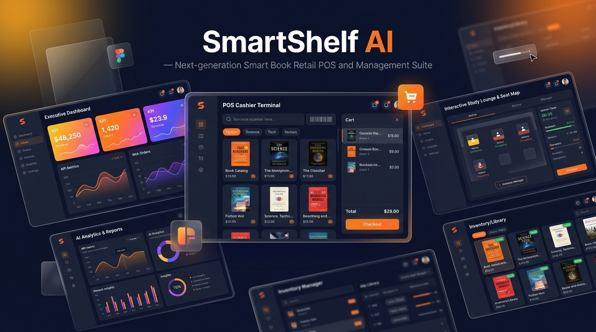

<p align="center">
  
</p>

# SmartShelf AI

### Enterprise Point of Sale, Library Lounge & Book Retail Management Suite

SmartShelf AI is a modern retail point-of-sale and store operations platform engineered specifically for contemporary bookstores, library study lounges, and hybrid retail cafes. Built with Laravel 12, Inertia.js v2, React 18, and Tailwind CSS, SmartShelf AI unifies fast-paced cashier workflows, automated inventory controls, study lounge seating timers, patron book lending, and AI-driven business intelligence into a single cohesive interface.

---

## Key System Modules

### 1. Executive Dashboard
- Real-time KPI tracking: Total Sales, Order Volume, Units Sold, and Revenue Growth.
- Interactive sales trend visualization with segmented time filtering (Today, Week, Month).
- Automated low-stock radar with immediate restocking actions.
- Real-time transaction stream and recent order feed.

### 2. Modern POS Cashier Terminal
- Instant barcode scanning and real-time ISBN lookup.
- Visual category filtering (Fiction, Non-Fiction, Tech, Science, Academic, Children).
- Dynamic shopping cart with live discount application, promotional codes, and tax calculation.
- Multi-channel payment split processing (Cash, Card, Digital/Mobile, Store Credit).
- On-demand receipt generation with thermal printer support and PDF/HTML export.

### 3. Inventory and Book Catalog
- Detailed book metadata management: ISBN, Author, Publisher, Edition, Cost, and Retail Price.
- Reorder threshold alerts to prevent stockouts of high-demand titles.
- In-browser barcode label generation using JsBarcode.
- Multi-tier classification and categorization.

### 4. Interactive Study Lounge and Cafe Manager
- Visual seat and table layout mapping with real-time occupancy indicators.
- Live session countdown timers for study bookings and coworking tables.
- Integrated refreshment and cafe snacks billing linked directly to session tabs.
- Automated check-in and check-out workflows with duration-based fee calculation.

### 5. Library and Book Lending System
- Patron account records and borrowing privilege tracking.
- Automated due date calculation and overdue fine assessment.
- Book checkout, return, renewal, and lost item logging.

### 6. Sales and Transaction Records
- Complete audit trails for every processed transaction.
- Invoice generation, re-printing, and detailed receipt archiving.
- Order refund and item exchange handling.

### 7. AI Analytics and Intelligent Reporting
- Sales velocity metrics and top-performing book rankings.
- Inventory turnover calculations and dead-stock identification.
- Cashier shift performance and employee sales metrics.
- Exportable financial and inventory audit statements.

### 8. Promotions and Discount Engine
- Time-limited promotional campaigns and bulk volume pricing.
- Custom coupon codes and student/member discounts.
- Dynamic calculation at the POS terminal level.

### 9. Supplier and Purchase Order Workflows
- Purchase order lifecycle management (Draft, Sent, Received, Closed).
- Supplier database and vendor fulfillment histories.
- Direct stock intake and inventory balance synchronization.

### 10. Role-Based Access Control (RBAC)
- Multi-tier user roles: Admin, Store Manager, Cashier, Lounge Manager, and Inventory Specialist.
- Granular permission enforcement across views, actions, and administrative settings.
- Secure session handling via Laravel Sanctum and Breeze.

---

## Technology Stack

### Backend
- **Framework:** Laravel 12 (PHP 8.2+)
- **Routing and SPA Adapter:** Inertia.js v2
- **Authentication:** Laravel Breeze / Laravel Sanctum
- **Document Generation:** Barryvdh Laravel DomPDF
- **Database Support:** SQLite, MySQL, PostgreSQL

### Frontend
- **Library:** React 18
- **Styling:** Tailwind CSS with custom design tokens
- **Icons:** Lucide React, Heroicons
- **Data Visualization:** Recharts, ApexCharts
- **Barcode Engine:** JsBarcode
- **Client Utilities:** Axios, Lodash, Date-fns, Clsx, Tailwind-Merge

---

## Directory Structure

```text
smart-pos-Ai/
├── app/
│   ├── Http/
│   │   ├── Controllers/       # POS, Dashboard, Inventory, Lounge controllers
│   │   ├── Middleware/        # RBAC and session validation middleware
│   │   └── Requests/          # Form request validators
│   └── Models/                # Eloquent models (Product, Sale, Customer, LoungeSession)
├── database/
│   ├── factories/             # Test and mock data factories
│   ├── migrations/            # Database schema definitions
│   └── seeders/               # Initial system seeders
├── docs/
│   └── images/                # Product screenshots and banner assets
├── resources/
│   ├── css/
│   │   └── app.css            # Global CSS variables, theme design tokens
│   └── js/
│       ├── Components/        # Reusable UI widgets and layout partials
│       ├── Layouts/           # MainLayout, Sidebar, Header
│       ├── Pages/             # Inertia view pages (POS, Dashboard, Lounge, etc.)
│       └── hooks/             # Custom React hooks (useCurrency, etc.)
├── routes/
│   ├── web.php                # Application web routes
│   └── auth.php               # Authentication routing definitions
└── vite.config.js             # Vite bundler configuration
```

---

## Getting Started

### Prerequisites
- PHP 8.2 or higher
- Composer 2.x
- Node.js 18.x or higher and npm
- SQLite or MySQL

### Installation Steps

1. **Clone the repository:**
   ```bash
   git clone https://github.com/avishka-hashara/SmartShelf-AI-book-Retail-Suite.git
   cd SmartShelf-AI-book-Retail-Suite
   ```

2. **Install PHP dependencies:**
   ```bash
   composer install
   ```

3. **Install JavaScript dependencies:**
   ```bash
   npm install
   ```

4. **Configure environment variables:**
   ```bash
   cp .env.example .env
   php artisan key:generate
   ```

5. **Run database migrations and seeders:**
   ```bash
   php artisan migrate --seed
   ```

6. **Start the local development server:**
   ```bash
   # Option A: Run concurrently (Vite + Laravel + Queue)
   composer dev

   # Option B: Run separately
   php artisan serve
   npm run dev
   ```

7. **Access the application:**
   Open your browser and navigate to `http://localhost:8000`.

---

## Default User Roles

| Role | Access Level | Description |
|---|---|---|
| Admin | Full Access | Complete system configuration, user management, and financial audits |
| Manager | Elevated | Store operations, inventory adjustments, promotions, and reports |
| Cashier | POS Terminal | Sales checkout, customer lookups, and receipt printing |
| Lounge Manager | Lounge Hub | Table/seat bookings, session timers, and cafe snack orders |
| Inventory | Stock Management | Product catalog, purchase orders, and supplier intake |

---

## License

This project is open-sourced software licensed under the [MIT license](LICENSE).
